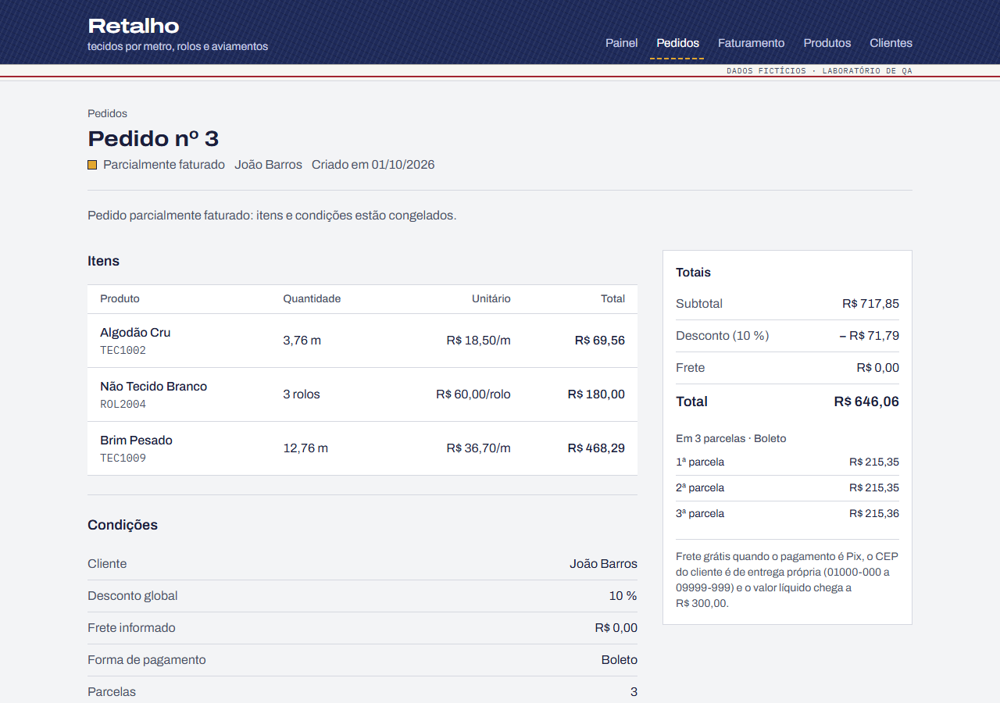
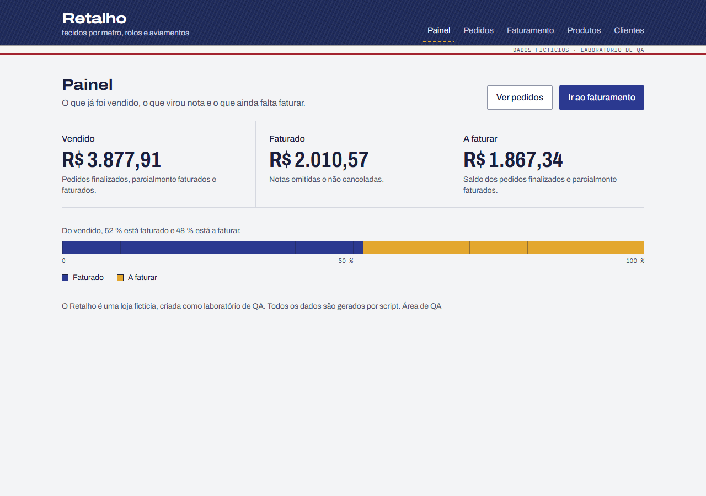
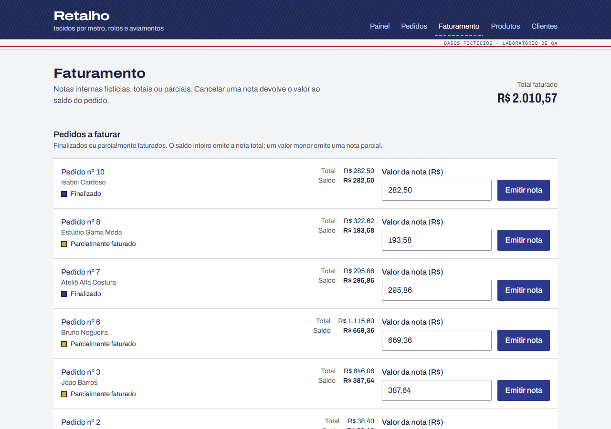
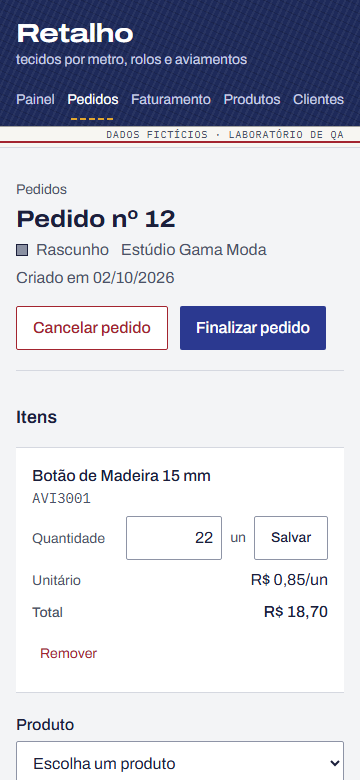
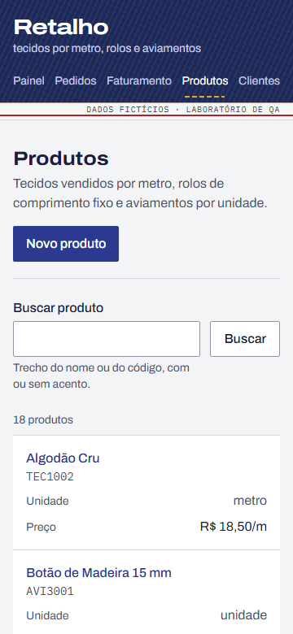

# Projeto Retalho

[](https://github.com/samuel-gonzaga/retalho-qa/actions/workflows/ci.yml)

O Retalho é uma loja de tecidos fictícia que vende tecido por metro, rolos de comprimento fixo e
aviamentos por unidade. É uma aplicação web funcional, com produtos, clientes, pedidos,
faturamento e painel. Ela tem **7 defeitos intencionais**, que podem ser ligados um a um, e uma
suíte de QA completa que encontra cada um deles.



## Por que existe

O autor trabalha como QA júnior, com teste exploratório e documentação de bugs num ERP desktop.
Este repositório é uma peça de portfólio que mostra duas coisas:

1. **Técnica de QA levada para a web:** partição de equivalência, valor limite, tabela de
   decisão, transição de estados, rastreabilidade, bug reports e teste exploratório com charters.
2. **Capacidade de construir:** especificação, domínio, API, banco, interface, testes
   automatizados e integração contínua, tudo numa só linguagem (TypeScript).

## Em números

| Item                              | Quantidade                                                            |
| --------------------------------- | --------------------------------------------------------------------- |
| Requisitos numerados              | 51 (40 funcionais, 11 não funcionais), cada um com critério de aceite |
| Casos de teste projetados         | 73, com 4 tabelas formais (uma por técnica)                           |
| Testes automatizados              | 367: 266 unitários, 80 de API e 21 E2E                                |
| Defeitos intencionais             | 7, cada um detectado por testes etiquetados nas três suítes           |
| Cobertura de código               | 98,0 % das linhas do domínio, serviços, banco e rotas de API          |
| Requisitos com teste automatizado | 49 de 51 (96 %); todos têm caso de teste                              |
| Jobs de CI a cada PR              | 12, incluindo a matriz de defeitos dos E2E                            |

Os números vêm de execuções reais e são regenerados por script; ver
[`qa/06-relatorio-de-execucao.md`](qa/06-relatorio-de-execucao.md).

## Capturas

| Painel                                                                | Faturamento                                                                 |
| --------------------------------------------------------------------- | --------------------------------------------------------------------------- |
|  |  |

| Pedido no celular (360 px)                                         | Produtos no celular (360 px)                                        |
| ------------------------------------------------------------------ | ------------------------------------------------------------------- |
|  |  |

A direção visual está em [`docs/DESIGN.md`](docs/DESIGN.md). O único elemento ousado é o
cabeçalho, feito como a ourela de um jeans (sarja índigo, pesponto e fio carmim); o resto é sóbrio.

## Como rodar

Requer Node.js 22 ou mais novo.

```bash
npm install
npm run seed
npm run dev
```

Abra `http://localhost:3000`. O `next dev` bloqueia o acesso por `127.0.0.1`; use `localhost`.

| Tela        | Endereço       | O que faz                                              |
| ----------- | -------------- | ------------------------------------------------------ |
| Painel      | `/`            | Vendido, faturado e a faturar                          |
| Pedidos     | `/pedidos`     | Itens, desconto, frete, parcelas, finalizar e cancelar |
| Faturamento | `/faturamento` | Notas totais ou parciais, saldo e cancelamento de nota |
| Produtos    | `/produtos`    | Tecido por metro, rolos e aviamentos: busca e cadastro |
| Clientes    | `/clientes`    | PF e PJ, com CPF, CNPJ (inclusive alfanumérico) e CEP  |

| Comando                      | O que faz                                                           |
| ---------------------------- | ------------------------------------------------------------------- |
| `npm run dev`                | Sobe a aplicação em modo de desenvolvimento                         |
| `npm run seed`               | Recria a massa fictícia (sempre a mesma) em `data/retalho.db`       |
| `npm run lint`               | ESLint (zero avisos) e verificação do Prettier                      |
| `npm run typecheck`          | Gera os tipos do Next e roda o TypeScript                           |
| `npm test`                   | Testes unitários (Vitest)                                           |
| `npm run test:api`           | Testes de API (Vitest, banco em memória)                            |
| `npm run test:e2e`           | Testes E2E (Playwright), desktop e celular em 360 px                |
| `npm run test:defeitos`      | Matriz de defeitos: unitários e API com cada defeito ligado         |
| `npm run test:e2e:defeitos`  | Matriz de defeitos dos E2E: a suíte inteira com cada defeito ligado |
| `npm run docs:check`         | Confere os IDs citados na documentação, no código e nos testes      |
| `npm run qa:rastreabilidade` | Gera a matriz de rastreabilidade a partir de uma execução real      |
| `npm run qa:relatorio`       | Gera o relatório de execução, com cobertura e matriz de defeitos    |

Para os E2E, instale o navegador uma vez com `npx playwright install chromium`.

## Como ligar cada defeito

Todos os defeitos ficam desligados por padrão; com todos desligados, o sistema segue a
[especificação](docs/SPEC.md). Há três formas de ligar um defeito.

Ao iniciar, pela variável de ambiente:

```bash
RETALHO_BUGS=2 npm run dev
```

Com o servidor rodando, pela página `/qa/defeitos` (disponível fora de produção), que tem uma
chave por defeito, ou pela API, como fazem os testes:

```bash
curl -X PUT http://localhost:3000/api/qa/bugs -H 'content-type: application/json' -d '{"active":[2]}'
```

Cada defeito vive em um único ponto do código, marcado com `// BUG-n` e ligado por `isBugOn(n)`.
Nenhuma tela avisa que um defeito está ligado: quem testa precisa encontrá-lo. Depois de uma
sessão com defeito ligado, rode `npm run seed` de novo, porque desligar o defeito não conserta os
dados que ele já gravou.

<details>
<summary>Lista dos defeitos (abra só depois de explorar)</summary>

| Defeito                               | Área                          | O que acontece                                                          |
| ------------------------------------- | ----------------------------- | ----------------------------------------------------------------------- |
| [BUG-01](qa/03-bug-reports/BUG-01.md) | Pedido · cálculo              | Editar a quantidade faz o desconto global sumir do total                |
| [BUG-02](qa/03-bug-reports/BUG-02.md) | Pedido · conversão de unidade | O unitário do rolo é dividido pela quantidade; com 1 rolo, nada aparece |
| [BUG-03](qa/03-bug-reports/BUG-03.md) | Pedido · estados              | Um pedido faturado aceita alteração das condições                       |
| [BUG-04](qa/03-bug-reports/BUG-04.md) | Pedido · parcelas             | R$ 100,00 em 3 parcelas soma R$ 99,99                                   |
| [BUG-05](qa/03-bug-reports/BUG-05.md) | Faturamento · saldo           | Cancelar uma nota não devolve o saldo do pedido                         |
| [BUG-06](qa/03-bug-reports/BUG-06.md) | Painel · consistência         | O painel mostra um faturado antigo, preso no cache                      |
| [BUG-07](qa/03-bug-reports/BUG-07.md) | Interface · atalho            | O botão Salvar anuncia Ctrl+S, que o navegador já usa                   |

</details>

## Do ERP desktop para a web

Cada defeito foi escolhido por ter um equivalente conhecido em sistemas desktop. A técnica que o
encontra é a mesma; muda a ferramenta.

| Defeito | Técnica de QA                                   | Equivalente num ERP desktop                                                   | Como encontrar na web                                             |
| ------- | ----------------------------------------------- | ----------------------------------------------------------------------------- | ----------------------------------------------------------------- |
| BUG-01  | Sequência de ações: editar depois de configurar | Grade de itens que não recalcula o rodapé depois que uma célula é editada     | Aplicar o desconto, editar a quantidade e conferir o total        |
| BUG-02  | Partição e valor limite (1 × 2 ou mais)         | Conversão de unidade de medida (caixa × unidade) testada só com quantidade 1  | Incluir 2 ou mais rolos e comparar o unitário com o preço do rolo |
| BUG-03  | Transição de estados: transição inválida        | Documento já faturado gravado por outra estação que ainda tinha a tela aberta | Duas abas, ou repetir a requisição pelas ferramentas do navegador |
| BUG-04  | Valor limite: divisão não exata                 | Parcelamento de título em que o centavo da divisão some                       | Escolher 3 parcelas num total não divisível e somar               |
| BUG-05  | Transição de estados: caminho de volta          | Estorno de nota que não reabre o saldo do pedido                              | Cancelar uma nota e olhar o estado e o saldo do pedido            |
| BUG-06  | Oráculo de comparação entre telas               | Relatório gerencial que lê um resumo antigo e diverge da consulta detalhada   | Abrir o painel, emitir uma nota e comparar com a lista de notas   |
| BUG-07  | Heurística de convenções da plataforma          | Tecla de atalho que o sistema operacional ou o terminal intercepta            | Ler o rótulo do botão e pressionar Ctrl+S                         |

| No desktop                              | Aqui                                                                          |
| --------------------------------------- | ----------------------------------------------------------------------------- |
| Print da tela anexado ao chamado        | Capturas e traces do Playwright; evidências geradas por `scripts/evidence.ts` |
| Consultar o banco para conferir a tela  | API REST e aba Rede das ferramentas do navegador                              |
| Roteiro de teste em planilha            | Casos com ID e técnica em `qa/02`, rastreados até o teste automatizado        |
| Massa de teste preparada à mão          | Seed fictício e determinístico (`npm run seed`)                               |
| Duas estações abertas no mesmo registro | Duas abas do navegador                                                        |
| Reteste manual a cada versão            | CI a cada PR, com a matriz de defeitos                                        |

## Artefatos de QA

| Artefato                                                        | Conteúdo                                                           |
| --------------------------------------------------------------- | ------------------------------------------------------------------ |
| [Plano de teste](qa/01-plano-de-teste.md)                       | Escopo, estratégia, ambiente, critérios de entrada e saída, riscos |
| [Casos de teste](qa/02-casos-de-teste.md)                       | 73 casos e as tabelas de partição, valor limite, decisão e estados |
| [Bug reports](qa/03-bug-reports/README.md)                      | Um por defeito, com passos, esperado × obtido e evidência          |
| [Matriz de rastreabilidade](qa/04-matriz-de-rastreabilidade.md) | Requisito → caso → teste automatizado → defeito                    |
| [Charters exploratórios](qa/05-charters-exploratorios.md)       | 3 sessões registradas, com achados, perguntas e tempo              |
| [Relatório de execução](qa/06-relatorio-de-execucao.md)         | Resultado real das suítes, das matrizes de defeitos e da cobertura |

A exploração encontrou também um defeito real, fora dos 7 plantados: o painel não percebia
gravações feitas por outro processo, como o seed rodado com o servidor aberto. Ele foi corrigido
com teste de regressão (achado A-04 em [`qa/05`](qa/05-charters-exploratorios.md)).

## Estrutura do repositório

```text
.
├── src/
│   ├── domain/        regras puras: cálculos, documentos, estados, validação e defeitos (bugs.ts)
│   ├── server/        serviços que juntam domínio e banco
│   ├── db/            esquema SQLite, conexão e seed
│   ├── app/           telas (App Router) e rotas da API em app/api
│   └── components/    componentes de interface
├── tests/
│   ├── unit/          Vitest: domínio
│   ├── api/           Vitest: rotas chamadas no processo, com banco em memória
│   └── e2e/           Playwright: desktop e celular
├── qa/                artefatos de QA
├── docs/              especificação, design, decisões, pendências, progresso e capturas
├── scripts/           matrizes de defeitos, rastreabilidade, relatório, evidências, capturas
└── .github/workflows/ integração contínua
```

## Tecnologia

Next.js (App Router) com TypeScript estrito e Tailwind, rotas de API no próprio Next, SQLite
(better-sqlite3), Vitest para unitários e API, Playwright para E2E e GitHub Actions. As fontes são
livres (Archivo e IBM Plex Mono) e não há imagens de terceiros.

## Documentação

- [`docs/SPEC.md`](docs/SPEC.md): requisitos, máquina de estados, contrato da API, mensagens de
  erro e os defeitos intencionais.
- [`docs/DESIGN.md`](docs/DESIGN.md): direção de design, tokens, revisão contra a especificação e
  autocrítica.
- [`docs/DECISOES.md`](docs/DECISOES.md): cada decisão tomada, com alternativas e motivo.
- [`docs/PENDENCIAS.md`](docs/PENDENCIAS.md): o que ficou em aberto.
- [`docs/PROGRESSO.md`](docs/PROGRESSO.md): fases, commits e resultado de cada push.

## Como foi feito

O projeto foi construído em seis fases por um agente de IA (Claude Code), que trabalhou de forma
autônoma a partir de um roteiro escrito pelo autor; os commits registram a coautoria. As sessões
exploratórias de [`qa/05`](qa/05-charters-exploratorios.md) foram conduzidas pelo agente, com
navegador automatizado, e o documento diz isso.

Todos os dados são fictícios e gerados por script. Nenhuma empresa, pessoa ou sistema real é
citado.
