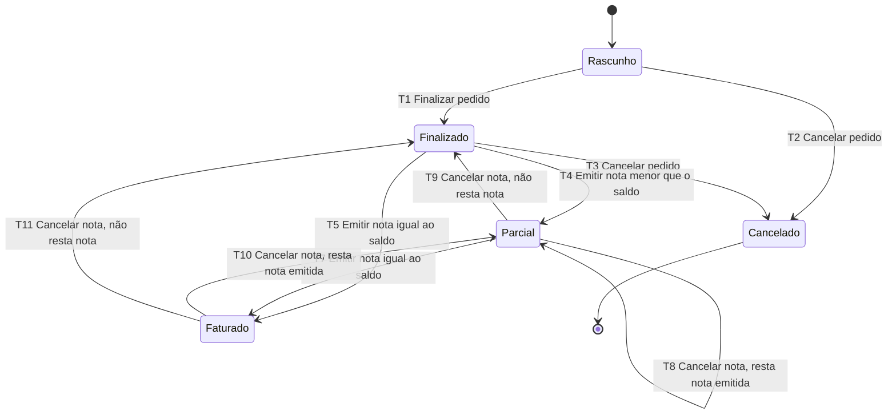

# Especificação do Retalho

O Retalho é uma loja de tecidos fictícia. Ela vende tecido por metro, rolos de comprimento fixo
e aviamentos por unidade. Este documento é a fonte da verdade do sistema: cada comportamento
esperado tem um ID, e os testes, os casos de teste e os bug reports citam esses IDs.

Com todos os defeitos intencionais desligados, o sistema deve seguir esta especificação à risca.
Os defeitos estão descritos na seção [Defeitos intencionais](#12-defeitos-intencionais).

## 1. Convenções

### 1.1 Identificadores

| Prefixo  | Significado                 | Onde é definido           |
| -------- | --------------------------- | ------------------------- |
| `RF-nn`  | Requisito funcional         | Este documento            |
| `RNF-nn` | Requisito não funcional     | Este documento            |
| `BUG-0n` | Defeito intencional (1 a 7) | Este documento (seção 12) |
| `CT-nn`  | Caso de teste               | `qa/02-casos-de-teste.md` |
| `D-nn`   | Decisão tomada sem consulta | `docs/DECISOES.md`        |
| `P-nn`   | Pendência                   | `docs/PENDENCIAS.md`      |

No código, o ponto onde um defeito é injetado é marcado com o comentário `// BUG-n` (sem o zero à
esquerda). Todo requisito tem um **critério de aceite** verificável. O comando `npm run
docs:check` confirma que os IDs são únicos, que todo requisito tem critério de aceite e que
nenhum documento cita um ID inexistente.

### 1.2 Valores, quantidades e arredondamento

- **Dinheiro** é guardado em centavos inteiros e exibido como `R$ 1.234,56`.
- **Quantidades** têm até 2 casas decimais e são exibidas com vírgula (`2,35 m`).
- **Arredondamento:** meio para cima, no centavo (R$ 0,005 vira R$ 0,01). Ele é aplicado em
  três pontos: no preço do rolo, no total de cada item e no valor do desconto. Nenhum outro
  cálculo arredonda.

### 1.3 Glossário

| Termo           | Definição                                                                |
| --------------- | ------------------------------------------------------------------------ |
| Subtotal        | Soma dos totais dos itens do pedido                                      |
| Desconto        | Valor em reais obtido do percentual de desconto global sobre o subtotal  |
| Valor líquido   | Subtotal − desconto                                                      |
| Frete informado | Valor de frete digitado no pedido                                        |
| Frete cobrado   | O frete informado, ou R$ 0,00 quando o pedido tem frete grátis (RF-20)   |
| Total           | Valor líquido + frete cobrado                                            |
| Saldo           | Parte do total ainda não faturada: total − notas emitidas não canceladas |
| Nota            | Nota interna fictícia de faturamento (não é documento fiscal)            |

## 2. Produtos

### RF-01 · Cadastrar produto

Um produto tem código, nome, unidade de venda, preço e, se for rolo, comprimento.

| Campo               | Regra                                                                     |
| ------------------- | ------------------------------------------------------------------------- |
| Código              | 3 a 12 caracteres, só letras maiúsculas (A–Z) e dígitos                   |
| Nome                | 2 a 80 caracteres, sem contar espaços nas pontas                          |
| Unidade             | `metro`, `rolo` ou `unidade`                                              |
| Preço               | R$ 0,01 a R$ 99.999,99. Por metro (metro e rolo) ou por unidade (unidade) |
| Comprimento do rolo | Obrigatório só para rolo: de 0,01 a 500 m, até 2 casas decimais           |

Enviar comprimento para um produto que não é rolo é um erro.

**Aceite:** um cadastro válido devolve 201 com o produto criado. Cada campo fora da regra devolve
422 `VALIDATION_ERROR`, com a mensagem do campo (seção 11.2), e nada é gravado.

### RF-02 · Código de produto único

Dois produtos não podem ter o mesmo código, nem no cadastro nem na edição.

**Aceite:** cadastrar ou editar um produto com um código já usado devolve 409
`DUPLICATE_PRODUCT_CODE` e nada é gravado.

### RF-03 · Editar produto

A edição segue as mesmas regras do cadastro. Os itens já lançados em pedidos guardam nome, unidade,
comprimento e preço do momento da inclusão. Editar o produto não altera esses itens.

**Aceite:** alterar o preço de um produto que já está num pedido em rascunho não muda o item
lançado. Um item incluído depois da alteração usa o preço novo.

### RF-04 · Buscar produtos

A busca encontra produtos por trecho do nome ou do código, sem diferenciar maiúsculas,
minúsculas e acentos. Sem termo de busca, a lista mostra todos os produtos em ordem alfabética.
Cada resultado mostra código, nome, unidade e preço com a unidade (`R$ 4,00/m`,
`R$ 20,00 o rolo de 5 m`, `R$ 1,50/un`).

**Aceite:** `linho` encontra "Linho Misto"; `algodao` encontra "Algodão Cru"; `tec10` encontra o
código `TEC1001`. Uma busca sem resultado mostra um estado vazio que repete o termo buscado e
sugere conferir a grafia ou cadastrar o produto.

### RF-05 · Preço do rolo

O preço de um rolo é o comprimento multiplicado pelo preço por metro, arredondado ao centavo.

**Aceite:** rolo de 5 m a R$ 4,00/m custa R$ 20,00. Rolo de 2,5 m a R$ 3,33/m custa R$ 8,33
(R$ 8,325 arredondado para cima).

## 3. Clientes

### RF-06 · Cadastrar cliente

Um cliente é pessoa física (PF) ou jurídica (PJ). Tem nome (2 a 120 caracteres, sem contar
espaços nas pontas), documento e CEP. O documento de PF é o CPF e o de PJ é o CNPJ.

**Aceite:** um cadastro válido devolve 201. Um CPF num cliente PJ, ou um CNPJ num cliente PF,
devolve 422 com a mensagem do campo documento.

### RF-07 · Validar CPF

O CPF tem 11 dígitos e é aceito com ou sem máscara (`000.000.000-00`). Os dois dígitos
verificadores seguem o algoritmo público de módulo 11:

1. Some os 9 primeiros dígitos multiplicados pelos pesos 10 a 2.
2. Calcule o resto da divisão da soma por 11. Se o resto for menor que 2, o dígito é 0; senão, é
   11 − resto.
3. Repita com os 10 primeiros dígitos e os pesos 11 a 2 para obter o segundo dígito.

Sequências de 11 dígitos iguais são rejeitadas, mesmo com dígitos verificadores coerentes. O
CPF é gravado só com dígitos e exibido com máscara.

**Aceite:** um CPF com dígitos verificadores corretos é aceito com e sem máscara. Alterar um dígito
verificador, enviar 11 dígitos iguais ou enviar 10 ou 12 dígitos devolve 422.

### RF-08 · Validar CNPJ

O CNPJ tem 14 caracteres: 12 alfanuméricos (A–Z e 0–9) e 2 dígitos verificadores numéricos. O
formato alfanumérico convive com o numérico, que é o caso em que os 12 primeiros caracteres são
dígitos. O CNPJ é aceito com ou sem máscara (`00.000.000/0000-00`), e letras minúsculas são
convertidas para maiúsculas. O cálculo dos dígitos verificadores:

1. Cada caractere vale o seu código ASCII menos 48. Os dígitos valem de 0 a 9, e `A` vale 17.
2. Some os 12 primeiros valores multiplicados pelos pesos 5, 4, 3, 2, 9, 8, 7, 6, 5, 4, 3, 2.
3. Se o resto da divisão por 11 for menor que 2, o dígito é 0; senão, é 11 − resto.
4. Repita com os 13 primeiros valores e os pesos 6, 5, 4, 3, 2, 9, 8, 7, 6, 5, 4, 3, 2.

Exemplo do algoritmo: a base `12ABC34501DE` gera os dígitos `35` (`12.ABC.345/01DE-35`).
Sequências de 14 caracteres iguais são rejeitadas.

**Aceite:** `12.ABC.345/01DE-35` e um CNPJ numérico com dígitos corretos são aceitos. Alterar um
dígito verificador, usar caractere fora de A–Z e 0–9, enviar `00.000.000/0000-00` ou enviar 13 ou
15 caracteres devolve 422.

### RF-09 · Validar CEP

O CEP tem 8 dígitos, com ou sem hífen. Ele é gravado e exibido no formato `00000-000`.

**Aceite:** `12345678` e `12345-678` são aceitos e gravados como `12345-678`. `1234-567`,
`123456789` e `12345-67a` devolvem 422.

### RF-10 · Documento único

Dois clientes não podem ter o mesmo documento. A comparação ignora a máscara.

**Aceite:** cadastrar ou editar um cliente com um documento já usado, com ou sem máscara, devolve
409 `DUPLICATE_DOCUMENT` e nada é gravado.

### RF-11 · Editar e buscar clientes

A edição segue as regras do cadastro (RF-06 a RF-10). A busca encontra clientes por trecho do
nome, sem diferenciar maiúsculas, minúsculas e acentos, ou pelos dígitos do documento.

**Aceite:** `joao` encontra "João"; digitar parte dos dígitos do CPF, sem máscara, encontra o
cliente. Uma busca sem resultado mostra um estado vazio que repete o termo buscado.

## 4. Pedido

### RF-12 · Listar pedidos

A lista mostra número, cliente, estado, total e saldo de cada pedido, do mais recente para o mais
antigo. Pode ser filtrada por estado.

**Aceite:** o filtro "Faturado" mostra só pedidos faturados. Sem pedidos, a lista mostra um estado
vazio que oferece a ação "Novo pedido".

### RF-13 · Criar pedido

Um pedido nasce em **rascunho** para um cliente cadastrado, com número sequencial a partir de 1.
Começa com desconto de 0 %, frete informado de R$ 0,00, pagamento por Pix e 1 parcela.

**Aceite:** criar um pedido devolve 201 em rascunho com esses valores. Informar um cliente
inexistente devolve 422 com a mensagem do campo cliente.

### RF-14 · Incluir item

Um item é um produto cadastrado mais uma quantidade (RF-15). Ao incluir, o item copia nome,
unidade, comprimento e preço do produto (RF-03). Cada produto aparece no máximo uma vez no
pedido.

**Aceite:** incluir um item devolve 201 e recalcula os totais. Incluir um produto que já está no
pedido devolve 409 `DUPLICATE_ITEM`. Incluir um produto inexistente devolve 422.

### RF-15 · Quantidade do item

A quantidade vai de 0,01 a 1.000, com os dois limites incluídos. Para metro, aceita até 2 casas
decimais. Rolo e unidade aceitam só quantidades inteiras.

**Aceite:** a tabela de valores limite abaixo, em que "aceita" devolve 201 (inclusão) ou 200
(edição) e "422" devolve `VALIDATION_ERROR` sem gravar nada.

| Quantidade | Metro         | Rolo ou unidade |
| ---------- | ------------- | --------------- |
| 0          | 422           | 422             |
| 0,01       | aceita        | 422 (inteiro)   |
| 1          | aceita        | aceita          |
| 2          | aceita        | aceita          |
| 1,25       | aceita        | 422 (inteiro)   |
| 1,255      | 422 (3 casas) | 422             |
| 1.000      | aceita        | aceita          |
| 1.000,01   | 422           | 422             |
| 1.001      | 422           | 422             |

### RF-16 · Preço unitário e total do item

O preço unitário depende da unidade:

- **metro:** o preço por metro;
- **rolo:** o preço do rolo (RF-05);
- **unidade:** o preço por unidade.

O total do item é a quantidade vezes o preço unitário, arredondado ao centavo.

**Aceite:** 2,35 m a R$ 12,99/m somam R$ 30,53 (R$ 30,5265 arredondado). 4 rolos de 5 m a
R$ 4,00/m mostram unitário de R$ 20,00 e total de R$ 80,00. 1 rolo do mesmo produto mostra
unitário e total de R$ 20,00. 3 unidades a R$ 1,50 somam R$ 4,50.

### RF-17 · Editar quantidade e remover item

Em rascunho, a quantidade de um item pode ser alterada (RF-15) e o item pode ser removido. Toda
alteração recalcula o pedido inteiro, com desconto, frete e parcelas (RF-18 a RF-23).

**Aceite:** um pedido com desconto de 10 %, cliente com CEP na área local e pagamento por Pix tem
um item de 50 m a R$ 50,00/m (total de R$ 2.250,00, com frete grátis). Alterar a quantidade para
100 m deixa o total em R$ 4.500,00. Remover o item deixa o subtotal e o total em R$ 0,00 mais o
frete cobrado.

### RF-18 · Desconto global

O desconto é um percentual de 0 a 100, com os dois limites incluídos e até 2 casas decimais. O
valor do desconto é o subtotal vezes o percentual, arredondado ao centavo. O valor líquido é o
subtotal menos o desconto.

**Aceite:** −1 e 101 devolvem 422; 12,345 devolve 422 (3 casas). 0 não desconta nada. 100 deixa o
valor líquido em R$ 0,00. 12,5 é aceito. Um subtotal de R$ 10,05 com 10 % tem desconto de
R$ 1,01 (R$ 1,005 arredondado) e valor líquido de R$ 9,04.

### RF-19 · Frete informado

O frete informado vai de R$ 0,00 a R$ 9.999,99, com os dois limites incluídos.

**Aceite:** R$ 0,00 e R$ 9.999,99 são aceitos. −R$ 0,01 e R$ 10.000,00 devolvem 422.

### RF-20 · Frete grátis

O frete cobrado é R$ 0,00 quando as três condições abaixo são verdadeiras ao mesmo tempo. Nos
demais casos, o frete cobrado é igual ao frete informado.

| Condição | Descrição                                                               |
| -------- | ----------------------------------------------------------------------- |
| C1       | Valor líquido (subtotal − desconto) de pelo menos R$ 300,00             |
| C2       | Forma de pagamento Pix                                                  |
| C3       | CEP do cliente na área de entrega própria: de `01000-000` a `09999-999` |

Tabela de decisão completa (S = sim, N = não):

| Regra             | R1  | R2  | R3  | R4  | R5  | R6  | R7  | R8  |
| ----------------- | --- | --- | --- | --- | --- | --- | --- | --- |
| C1 líquido ≥ 300  | S   | S   | S   | S   | N   | N   | N   | N   |
| C2 Pix            | S   | S   | N   | N   | S   | S   | N   | N   |
| C3 CEP local      | S   | N   | S   | N   | S   | N   | S   | N   |
| **Frete grátis**  | X   |     |     |     |     |     |     |     |
| **Frete cobrado** |     | X   | X   | X   | X   | X   | X   | X   |

Na forma reduzida, basta uma condição falsa para o frete ser cobrado: R1 (todas verdadeiras),
C1 falsa (R5 a R8), C2 falsa (R3 e R4) e C3 falsa (R2).

**Aceite:** com Pix e CEP `01000-000`, um valor líquido de R$ 300,00 tem frete grátis e um de
R$ 299,99 paga o frete informado. Com valor líquido de R$ 300,00 e Pix, os CEPs `01000-000` e
`09999-999` têm frete grátis, e os CEPs `00999-999` e `10000-000` pagam o frete. Com valor
líquido de R$ 300,00 e CEP local, boleto e cartão pagam o frete. A tela do pedido mostra "Frete
grátis" quando a regra se aplica.

### RF-21 · Total do pedido

O total é o valor líquido mais o frete cobrado. Isso equivale a `soma dos itens × (1 − desconto)

- frete`, com os arredondamentos da seção 1.2.

**Aceite:** subtotal de R$ 5.000,00, desconto de 10 %, frete informado de R$ 50,00 e CEP local:
com Pix o total é R$ 4.500,00 (frete grátis); com boleto, R$ 4.550,00.

### RF-22 · Forma de pagamento e número de parcelas

A forma de pagamento é Pix, boleto ou cartão. O número de parcelas é um inteiro de 1 a 3,
para qualquer forma de pagamento.

**Aceite:** 1 e 3 parcelas são aceitas. 0, 4 e 1,5 devolvem 422. Uma forma de pagamento fora da
lista devolve 422.

### RF-23 · Valor das parcelas

As parcelas somam exatamente o total. Cada parcela, exceto a última, vale o total dividido pelo
número de parcelas, truncado no centavo. A última parcela absorve a diferença de centavos.

**Aceite:**

| Total       | Parcelas | Valores                        |
| ----------- | -------- | ------------------------------ |
| R$ 100,00   | 1        | R$ 100,00                      |
| R$ 100,00   | 2        | R$ 50,00 + R$ 50,00            |
| R$ 100,00   | 3        | R$ 33,33 + R$ 33,33 + R$ 33,34 |
| R$ 10,00    | 3        | R$ 3,33 + R$ 3,33 + R$ 3,34    |
| R$ 0,10     | 3        | R$ 0,03 + R$ 0,03 + R$ 0,04    |
| R$ 4.500,00 | 3        | R$ 1.500,00 nas três parcelas  |

### RF-24 · Valores congelados na finalização

Em rascunho, o pedido é recalculado a cada alteração (itens, desconto, frete, pagamento,
parcelas ou cliente). Ao finalizar, total, frete cobrado e parcelas ficam fixos. Alterações
posteriores no produto ou no cliente não mudam o pedido.

**Aceite:** finalizar um pedido com frete grátis e depois mudar o CEP do cliente para fora da área
local não muda o frete cobrado nem o total do pedido.

## 5. Estados do pedido

| Estado                | Valor na API         | Significado                                     |
| --------------------- | -------------------- | ----------------------------------------------- |
| Rascunho              | `draft`              | Em edição; o único estado que aceita alterações |
| Finalizado            | `finalized`          | Valores congelados; aguarda faturamento         |
| Parcialmente faturado | `partially_invoiced` | Tem nota emitida e saldo maior que zero         |
| Faturado              | `invoiced`           | As notas emitidas cobrem o total; saldo zero    |
| Cancelado             | `canceled`           | Encerrado com motivo; estado final              |

No diagrama, "Parcial" é o estado Parcialmente faturado.

### RF-25 · Transições válidas

| ID  | De                    | Ação             | Para                  | Condição                         |
| --- | --------------------- | ---------------- | --------------------- | -------------------------------- |
| T1  | Rascunho              | Finalizar pedido | Finalizado            | Ao menos 1 item (RF-28)          |
| T2  | Rascunho              | Cancelar pedido  | Cancelado             | Motivo válido (RF-29)            |
| T3  | Finalizado            | Cancelar pedido  | Cancelado             | Motivo válido (RF-29)            |
| T4  | Finalizado            | Emitir nota      | Parcialmente faturado | Valor menor que o saldo (RF-32)  |
| T5  | Finalizado            | Emitir nota      | Faturado              | Valor igual ao saldo (RF-32)     |
| T6  | Parcialmente faturado | Emitir nota      | Parcialmente faturado | Valor menor que o saldo          |
| T7  | Parcialmente faturado | Emitir nota      | Faturado              | Valor igual ao saldo             |
| T8  | Parcialmente faturado | Cancelar nota    | Parcialmente faturado | Resta outra nota emitida (RF-34) |
| T9  | Parcialmente faturado | Cancelar nota    | Finalizado            | Não resta nota emitida (RF-34)   |
| T10 | Faturado              | Cancelar nota    | Parcialmente faturado | Resta outra nota emitida         |
| T11 | Faturado              | Cancelar nota    | Finalizado            | Não resta nota emitida           |

**Aceite:** cada transição, executada a partir do estado de origem e com a condição atendida, leva
ao estado de destino. A API devolve 200, ou 201 na emissão de nota.

### RF-26 · Transições inválidas

Qualquer ação fora da tabela de RF-25 é recusada e não muda nada: nem estado, nem valores, nem
histórico. A matriz abaixo mostra a resposta da API para cada ação em cada estado.

| Estado ↓ · Ação →     | Salvar e itens | Finalizar pedido     | Cancelar pedido       | Emitir nota       | Cancelar nota     |
| --------------------- | -------------- | -------------------- | --------------------- | ----------------- | ----------------- |
| Rascunho              | 200 ou 201     | 200 (T1) · 422 vazio | 200 (T2) · 422 motivo | 409               | não há nota       |
| Finalizado            | 409            | 200 sem mudança      | 200 (T3) · 422 motivo | 201 (T4/T5) · 422 | 200 sem mudança ¹ |
| Parcialmente faturado | 409            | 409                  | 409                   | 201 (T6/T7) · 422 | 200 (T8/T9)       |
| Faturado              | 409            | 409                  | 409                   | 409               | 200 (T10/T11)     |
| Cancelado             | 409            | 409                  | 200 sem mudança       | 409               | 200 sem mudança ¹ |

¹ Nesses estados o pedido só pode ter notas já canceladas; repetir o cancelamento não muda nada.

O 409 de "Salvar e itens" tem o código `ORDER_NOT_EDITABLE` (RF-27). Os demais 409 têm o código
`INVALID_TRANSITION`. Ao cancelar um pedido parcialmente faturado ou faturado, a mensagem orienta
a cancelar as notas antes.

**Aceite:** cada célula 409 da matriz devolve o código indicado. Depois da chamada, estado, total,
saldo e histórico do pedido são os mesmos de antes.

### RF-27 · Alterações só em rascunho

Só um pedido em rascunho aceita alterações: salvar o cabeçalho (cliente, desconto, frete,
pagamento e parcelas) e incluir, editar ou remover itens. Em qualquer outro estado, a API devolve
409 `ORDER_NOT_EDITABLE` e não grava nada. A tela mostra os campos só para leitura fora do
rascunho.

**Aceite:** um PUT com desconto de 50 % em um pedido faturado devolve 409 `ORDER_NOT_EDITABLE`, e
o total do pedido continua igual. O mesmo vale para finalizado, parcialmente faturado e
cancelado, e para incluir, editar ou remover item.

### RF-28 · Finalizar pedido

Finalizar exige ao menos um item. Sem itens, a API devolve 422 `ORDER_INCOMPLETE`. Finalizar um
pedido que já está finalizado devolve 200 sem nenhuma mudança: a ação é idempotente, para que um
duplo clique em "Finalizar pedido" não tenha efeito duplicado.

**Aceite:** finalizar um rascunho com itens leva a Finalizado e grava um registro no histórico.
Duas chamadas seguidas, ou simultâneas, devolvem 200 e deixam exatamente um registro de
finalização no histórico. Finalizar um rascunho sem itens devolve 422.

### RF-29 · Cancelar pedido

Cancelar é permitido em rascunho e em finalizado e exige um motivo de 10 a 200 caracteres, sem
contar espaços nas pontas. Sem motivo válido, a API devolve 422 `REASON_REQUIRED`. Cancelar um
pedido já cancelado devolve 200 sem mudança e mantém o motivo original. Um pedido com nota emitida
precisa ter as notas canceladas antes (RF-26).

**Aceite:** motivo com 9 caracteres, vazio ou só com espaços devolve 422. Motivos com 10 e com 200
caracteres são aceitos. Um motivo com 201 caracteres devolve 422. O pedido cancelado mostra o
motivo e não aceita outras ações (RF-26).

### RF-30 · Histórico do pedido

Cada transição de estado grava um registro com estado de origem, estado de destino, data e hora
e, quando houver, o motivo. O histórico aparece na tela do pedido, do mais antigo para o mais
recente.

**Aceite:** um pedido criado, finalizado, faturado em duas notas e com uma nota cancelada mostra
quatro registros na ordem em que as transições aconteceram. Ações recusadas (RF-26) e repetições
idempotentes (RF-28, RF-29) não geram registro.

### RF-31 · Ordem de verificação dos erros

A API verifica nesta ordem e devolve o primeiro erro encontrado:

1. o recurso existe? Senão, 404 `NOT_FOUND`;
2. o estado permite a ação? Senão, 409;
3. os dados são válidos? Senão, 422.

Um corpo que não é JSON válido devolve 400 `INVALID_JSON` (RNF-11).

**Aceite:** PUT com desconto de 101 % em um pedido faturado devolve 409, não 422. PUT em um
pedido inexistente devolve 404, qualquer que seja o corpo.

## 6. Faturamento

### RF-32 · Emitir nota

Uma nota interna pode ser emitida para um pedido finalizado ou parcialmente faturado. O valor é
maior que zero e no máximo igual ao saldo. A nota recebe número sequencial, exibido com quatro
dígitos (`NI 0001`), e a data e hora da emissão. A tela oferece o saldo como valor sugerido.

**Aceite:** com saldo de R$ 200,00, uma nota de R$ 200,01 devolve 422 `AMOUNT_EXCEEDS_BALANCE`,
que informa o saldo disponível. Uma nota de R$ 0,00 devolve 422 `VALIDATION_ERROR`. Emitir nota
para um pedido em rascunho, faturado ou cancelado devolve 409.

### RF-33 · Saldo e estado após a emissão

O saldo é o total do pedido menos a soma das notas emitidas e não canceladas. Uma nota igual ao
saldo é uma nota **total** e leva o pedido a Faturado. Uma nota menor que o saldo é **parcial** e
leva o pedido a Parcialmente faturado.

**Aceite:** um pedido de R$ 300,00 com nota de R$ 100,00 fica Parcialmente faturado, com saldo de
R$ 200,00. Com uma segunda nota de R$ 200,00, fica Faturado, com saldo de R$ 0,00.

### RF-34 · Cancelar nota

Cancelar uma nota exige um motivo de 10 a 200 caracteres (mesma regra de RF-29). A nota passa a
Cancelada, o valor dela volta ao saldo do pedido e o estado é recalculado: Parcialmente faturado
se ainda resta nota emitida, ou Finalizado se não resta nenhuma. Cancelar uma nota já cancelada
devolve 200 sem mudança.

**Aceite:** um pedido de R$ 300,00, faturado com notas de R$ 100,00 e R$ 200,00: cancelar a nota de
R$ 200,00 deixa o pedido Parcialmente faturado com saldo de R$ 200,00. Cancelar também a nota de
R$ 100,00 deixa o pedido Finalizado com saldo de R$ 300,00, e uma nova nota pode ser emitida.

### RF-35 · Lista de notas

A lista mostra número da nota, número do pedido, cliente, valor, data de emissão e situação
(Emitida ou Cancelada, com o motivo), da mais recente para a mais antiga. No topo, mostra o total
faturado: a soma das notas emitidas e não canceladas.

**Aceite:** com notas emitidas de R$ 100,00 e R$ 200,00 e uma nota cancelada de R$ 50,00, o total
faturado da lista é R$ 300,00. Sem notas, a lista mostra um estado vazio que explica como emitir a
primeira nota a partir de um pedido finalizado.

## 7. Painel

### RF-36 · Vendido

Vendido é a soma dos totais dos pedidos em Finalizado, Parcialmente faturado e Faturado. Rascunho
e Cancelado não entram.

**Aceite:** com um rascunho de R$ 50,00, um pedido cancelado de R$ 70,00, um finalizado de
R$ 100,00 e um faturado de R$ 300,00, o vendido é R$ 400,00.

### RF-37 · Faturado

Faturado é a soma das notas emitidas e não canceladas. O valor é sempre igual ao total faturado
da lista de notas (RF-35).

**Aceite:** depois de qualquer emissão ou cancelamento de nota, o faturado do painel e o total da
lista de notas mostram o mesmo valor.

### RF-38 · A faturar

A faturar é a soma dos saldos dos pedidos em Finalizado e Parcialmente faturado. Vale sempre a
igualdade: vendido = faturado + a faturar.

**Aceite:** depois de qualquer sequência de finalizações, emissões e cancelamentos, os três valores
do painel satisfazem a igualdade.

### RF-39 · Painel sempre atualizado

O painel pode guardar os valores calculados em cache, mas cada ação que muda os números invalida
esse cache: finalizar pedido, cancelar pedido, emitir nota e cancelar nota. A próxima leitura do
painel já mostra os valores novos.

**Aceite:** abrir o painel, emitir uma nota de R$ 100,00 e abrir o painel de novo: o faturado
aumentou R$ 100,00 e o a faturar diminuiu R$ 100,00.

## 8. Interface

### RF-40 · Botões sem atalhos que conflitam com o navegador

Nenhum botão anuncia, no texto, na dica (`title`) ou em `aria-keyshortcuts`, um atalho de teclado
que o navegador já usa: Ctrl ou ⌘ combinado com S, P, N, T, W, R, F, D, L, H, J ou O. O botão que
grava as alterações do pedido em rascunho se chama "Salvar" e não tem atalho.

**Aceite:** na tela do pedido, o botão "Salvar" tem como nome acessível exatamente "Salvar" e não
tem `aria-keyshortcuts`. Nenhum botão de nenhuma tela anuncia um dos atalhos listados.

## 9. Requisitos não funcionais

### RNF-01 · Mecanismo de defeitos

Os 7 defeitos intencionais são ligados somente por `isBugOn(n)`, em `src/domain/bugs.ts`. A
variável `RETALHO_BUGS` define quais começam ligados (ex.: `1,3,5`); vazia, todos ficam
desligados. Valores fora de 1 a 7 ou que não são números inteiros são ignorados. A página
`/qa/defeitos` e a API `/api/qa/bugs` ligam e desligam defeitos com o servidor rodando. Essas
mudanças ficam na memória até o servidor reiniciar (D-04). A área de QA só existe fora de produção,
ou com `RETALHO_QA_PAINEL=1` (D-03).

**Aceite:** sem `RETALHO_BUGS`, todos os defeitos ficam desligados. Com `1,3,5`, exatamente esses
ficam ligados. Uma mudança feita na página vale para todas as telas. Em produção, sem
`RETALHO_QA_PAINEL=1`, a página e a API devolvem 404.

### RNF-02 · Defeitos silenciosos

Com qualquer defeito ligado, nenhuma tela fora de `/qa/defeitos` indica isso: não há banner,
aviso, cor ou texto diferente além do próprio efeito do defeito. Quem testa sem ler o código
precisa encontrar cada defeito por exploração.

**Aceite:** a mesma tela, com o defeito ligado e desligado, difere só no valor ou no
comportamento afetado pelo defeito.

### RNF-03 · Dados fictícios e massa determinística

Todos os dados são fictícios. `npm run seed` recria a massa de dados com semente fixa e gera
sempre o mesmo conteúdo. CPFs e CNPJs são gerados pelo algoritmo (RF-07, RF-08). Nomes de
clientes e produtos não se referem a pessoas, empresas ou marcas reais.

**Aceite:** rodar o seed duas vezes produz bancos com o mesmo conteúdo. Todos os documentos do seed
passam na validação de RF-07 e RF-08.

### RNF-04 · Persistência local

Os dados ficam num arquivo SQLite, no caminho de `RETALHO_DB_PATH` (padrão `data/retalho.db`). O
esquema é criado automaticamente. O arquivo nunca é versionado. Os testes automatizados usam um
banco próprio, isolado do banco de desenvolvimento.

**Aceite:** apagar o arquivo e rodar `npm run seed` recria o banco. `git ls-files` não lista nenhum
arquivo `.db` ou `.sqlite`.

### RNF-05 · Acessibilidade

A interface segue a WCAG 2.2 nível AA:

- todo campo tem rótulo visível;
- a mensagem de erro fica junto do campo, ligada a ele por `aria-describedby` e anunciada a
  leitores de tela;
- todo elemento interativo tem foco visível;
- o contraste é de pelo menos 4,5:1 para texto e 3:1 para texto grande e componentes;
- todo fluxo funciona só com teclado;
- estados e situações são comunicados por texto, não só por cor.

**Aceite:** o fluxo completo do pedido (criar, adicionar item, finalizar, emitir nota) é feito só
com teclado, com o foco sempre visível. Os pares de cor definidos em `docs/DESIGN.md` atingem os
contrastes mínimos.

### RNF-06 · Responsividade

Todas as telas funcionam de 360 px de largura até o desktop, sem rolagem horizontal da página.
Tabelas largas viram lista ou rolam dentro do próprio contêiner. Alvos de toque têm pelo menos
24 × 24 px.

**Aceite:** com a janela em 360 px, nenhuma tela tem `scrollWidth` do documento maior que 360 px.

### RNF-07 · Movimento reduzido

Com `prefers-reduced-motion: reduce`, animações e transições são desligadas ou viram trocas
instantâneas.

**Aceite:** com a preferência emulada, nenhuma animação ou transição dura mais que 0,01 s.

### RNF-08 · Estados de vazio, carregamento e erro

Toda lista e todo formulário têm textos para os estados vazio, carregando e erro. O texto diz o
que aconteceu e como seguir. Erros da API aparecem em linguagem de usuário, sem códigos técnicos.

**Aceite:** uma lista vazia oferece a ação de criar o primeiro registro. Uma falha ao carregar
mostra o que não carregou e um botão "Tentar de novo". Nenhuma tela mostra um código como
`VALIDATION_ERROR`.

### RNF-09 · Vocabulário consistente

Cada ação tem um único rótulo em todo o sistema:

| Ação                                  | Rótulo                                  |
| ------------------------------------- | --------------------------------------- |
| Gravar as alterações de um formulário | Salvar                                  |
| Criar um registro                     | Novo produto, Novo cliente, Novo pedido |
| Incluir um item no pedido             | Adicionar item                          |
| Retirar um item do pedido             | Remover                                 |
| Rascunho → Finalizado                 | Finalizar pedido                        |
| Encerrar o pedido com motivo          | Cancelar pedido                         |
| Faturar uma parte ou todo o saldo     | Emitir nota                             |
| Desfazer uma nota                     | Cancelar nota                           |
| Pesquisar numa lista                  | Buscar                                  |
| Sair de um formulário sem gravar      | Voltar                                  |

Estados do pedido: Rascunho, Finalizado, Parcialmente faturado, Faturado e Cancelado. Situações
da nota: Emitida e Cancelada.

**Aceite:** nenhuma tela usa sinônimos para essas ações, como Gravar, Confirmar, Excluir ou
Faturar.

### RNF-10 · Formatos brasileiros

A interface está em português do Brasil. Valores aparecem como `R$ 1.234,56`, datas como
`dd/mm/aaaa` e quantidades com vírgula. Os campos numéricos aceitam vírgula ou ponto como
separador decimal, sem separador de milhar.

**Aceite:** digitar `2,35` ou `2.35` na quantidade de um item vendido por metro grava 2,35 m.

### RNF-11 · Formato da API

A API recebe e devolve JSON. Rotas e chaves ficam em inglês (D-05). Todo erro tem o formato
`{ "error": { "code": "...", "message": "...", "fields": { "campo": "mensagem" } } }`, em que
`fields` aparece só em erros de validação. Um corpo que não é JSON válido devolve 400
`INVALID_JSON`.

**Aceite:** todas as respostas de erro dos endpoints da seção 10 seguem o formato. Enviar `abc`
como corpo de um POST devolve 400 `INVALID_JSON`.

## 10. Contrato da API

Valores em dinheiro são inteiros em centavos (campos terminados em `Cents`). Quantidades,
comprimentos e percentuais são números com até 2 casas decimais. Os erros possíveis de cada rota
estão na coluna "Erros"; o significado de cada código está na seção 11.

### 10.1 Produtos

| Método | Rota                 | Corpo                                           | Sucesso            | Erros              |
| ------ | -------------------- | ----------------------------------------------- | ------------------ | ------------------ |
| GET    | `/api/products?q=`   | —                                               | 200 `{ products }` | —                  |
| POST   | `/api/products`      | `{ code, name, unit, priceCents, rollLength? }` | 201 `{ product }`  | 400, 409, 422      |
| GET    | `/api/products/{id}` | —                                               | 200 `{ product }`  | 404                |
| PUT    | `/api/products/{id}` | igual ao POST                                   | 200 `{ product }`  | 400, 404, 409, 422 |

`unit` vale `meter`, `roll` ou `unit`. O produto devolvido inclui `rollPriceCents` quando é rolo.

### 10.2 Clientes

| Método | Rota                  | Corpo                           | Sucesso             | Erros              |
| ------ | --------------------- | ------------------------------- | ------------------- | ------------------ |
| GET    | `/api/customers?q=`   | —                               | 200 `{ customers }` | —                  |
| POST   | `/api/customers`      | `{ type, name, document, cep }` | 201 `{ customer }`  | 400, 409, 422      |
| GET    | `/api/customers/{id}` | —                               | 200 `{ customer }`  | 404                |
| PUT    | `/api/customers/{id}` | igual ao POST                   | 200 `{ customer }`  | 400, 404, 409, 422 |

`type` vale `PF` ou `PJ`.

### 10.3 Pedidos

| Método | Rota                              | Corpo                                                                    | Sucesso          | Erros              |
| ------ | --------------------------------- | ------------------------------------------------------------------------ | ---------------- | ------------------ |
| GET    | `/api/orders?status=`             | —                                                                        | 200 `{ orders }` | —                  |
| POST   | `/api/orders`                     | `{ customerId }`                                                         | 201 `{ order }`  | 400, 422           |
| GET    | `/api/orders/{id}`                | —                                                                        | 200 `{ order }`  | 404                |
| PUT    | `/api/orders/{id}`                | `{ customerId, discountPct, freightCents, paymentMethod, installments }` | 200 `{ order }`  | 400, 404, 409, 422 |
| POST   | `/api/orders/{id}/items`          | `{ productId, quantity }`                                                | 201 `{ order }`  | 400, 404, 409, 422 |
| PATCH  | `/api/orders/{id}/items/{itemId}` | `{ quantity }`                                                           | 200 `{ order }`  | 400, 404, 409, 422 |
| DELETE | `/api/orders/{id}/items/{itemId}` | —                                                                        | 200 `{ order }`  | 404, 409           |
| POST   | `/api/orders/{id}/finalize`       | —                                                                        | 200 `{ order }`  | 404, 409, 422      |
| POST   | `/api/orders/{id}/cancel`         | `{ reason }`                                                             | 200 `{ order }`  | 400, 404, 409, 422 |

`status` vale `draft`, `finalized`, `partially_invoiced`, `invoiced` ou `canceled`.
`paymentMethod` vale `pix`, `boleto` ou `card`. O PUT substitui todos os campos do cabeçalho.

O pedido devolvido tem: `id`, `number`, `status`, `customer`, `items` (cada um com `id`,
`productId`, `code`, `name`, `unit`, `rollLength`, `priceCents`, `unitPriceCents`, `quantity` e
`totalCents`), `subtotalCents`, `discountPct`, `discountCents`, `netCents`, `freightCents`,
`freightChargedCents`, `freeShipping`, `totalCents`, `paymentMethod`, `installments`,
`installmentPlan` (lista de `{ number, amountCents }`), `invoicedCents`, `balanceCents`,
`cancelReason`, `history` (lista de `{ from, to, at, reason }`), `createdAt` e `updatedAt`.

### 10.4 Notas

| Método | Rota                        | Corpo             | Sucesso                                | Erros              |
| ------ | --------------------------- | ----------------- | -------------------------------------- | ------------------ |
| GET    | `/api/invoices`             | —                 | 200 `{ invoices, totalInvoicedCents }` | —                  |
| POST   | `/api/orders/{id}/invoices` | `{ amountCents }` | 201 `{ invoice, order }`               | 400, 404, 409, 422 |
| POST   | `/api/invoices/{id}/cancel` | `{ reason }`      | 200 `{ invoice, order }`               | 400, 404, 422      |

A nota devolvida tem: `id`, `number`, `orderId`, `orderNumber`, `customerName`, `amountCents`,
`status` (`issued` ou `canceled`), `issuedAt`, `canceledAt` e `cancelReason`.

### 10.5 Painel

| Método | Rota             | Sucesso                                            |
| ------ | ---------------- | -------------------------------------------------- |
| GET    | `/api/dashboard` | 200 `{ soldCents, invoicedCents, toInvoiceCents }` |

### 10.6 Área de QA

| Método | Rota           | Corpo             | Sucesso        | Erros         |
| ------ | -------------- | ----------------- | -------------- | ------------- |
| GET    | `/api/qa/bugs` | —                 | 200 `{ bugs }` | 404           |
| PUT    | `/api/qa/bugs` | `{ active: [n] }` | 200 `{ bugs }` | 400, 404, 422 |
| DELETE | `/api/qa/bugs` | —                 | 200 `{ bugs }` | 404           |

O PUT liga exatamente os defeitos listados e desliga os demais. O DELETE descarta as mudanças
feitas com o servidor rodando e volta ao `RETALHO_BUGS`. As rotas devolvem 404 quando a área de
QA está indisponível (RNF-01).

## 11. Mensagens de erro

Toda mensagem diz o que aconteceu e como corrigir. A interface mostra a mensagem; o código serve
para testes e integrações.

### 11.1 Códigos

| Código                   | HTTP | Mensagem                                                                                    |
| ------------------------ | ---- | ------------------------------------------------------------------------------------------- |
| `INVALID_JSON`           | 400  | Não foi possível ler os dados enviados. Envie um JSON válido.                               |
| `NOT_FOUND`              | 404  | {Produto, Cliente, Pedido ou Nota} não encontrado. Confira o número informado.              |
| `DUPLICATE_PRODUCT_CODE` | 409  | Já existe um produto com o código {código}. Escolha outro código.                           |
| `DUPLICATE_DOCUMENT`     | 409  | Já existe um cliente com este {CPF ou CNPJ}. Busque o cadastro existente.                   |
| `DUPLICATE_ITEM`         | 409  | Este produto já está no pedido. Altere a quantidade do item existente.                      |
| `ORDER_NOT_EDITABLE`     | 409  | O pedido está {estado} e não aceita alterações. Só pedidos em rascunho podem ser alterados. |
| `INVALID_TRANSITION`     | 409  | Não é possível {ação} um pedido {estado}.                                                   |
| `VALIDATION_ERROR`       | 422  | Alguns campos estão inválidos. Corrija os campos indicados e tente de novo.                 |
| `ORDER_INCOMPLETE`       | 422  | Adicione ao menos um item antes de finalizar o pedido.                                      |
| `REASON_REQUIRED`        | 422  | Informe o motivo do cancelamento, com 10 a 200 caracteres.                                  |
| `AMOUNT_EXCEEDS_BALANCE` | 422  | O valor da nota ({valor}) passa do saldo a faturar ({saldo}). Informe até {saldo}.          |

Para cancelar um pedido parcialmente faturado ou faturado, a mensagem de `INVALID_TRANSITION`
acrescenta: "Cancele as notas emitidas antes de cancelar o pedido."

### 11.2 Mensagens por campo

Os erros de validação (`VALIDATION_ERROR`) trazem em `fields` a mensagem de cada campo inválido.

| Campo                 | Situação                                  | Mensagem                                                                    |
| --------------------- | ----------------------------------------- | --------------------------------------------------------------------------- |
| Produto · código      | Fora do formato                           | Use de 3 a 12 letras maiúsculas ou números, sem espaços.                    |
| Produto · nome        | Vazio ou fora do tamanho                  | Informe o nome com 2 a 80 caracteres.                                       |
| Produto · unidade     | Fora da lista                             | Escolha a unidade: metro, rolo ou unidade.                                  |
| Produto · preço       | Fora da faixa                             | Informe um preço entre R$ 0,01 e R$ 99.999,99.                              |
| Produto · comprimento | Rolo sem comprimento ou fora da faixa     | Informe o comprimento do rolo entre 0,01 e 500 m, com até 2 casas decimais. |
| Produto · comprimento | Enviado para metro ou unidade             | O comprimento só se aplica a produtos vendidos em rolo.                     |
| Cliente · tipo        | Fora da lista                             | Escolha pessoa física (PF) ou pessoa jurídica (PJ).                         |
| Cliente · nome        | Vazio ou fora do tamanho                  | Informe o nome com 2 a 120 caracteres.                                      |
| Cliente · documento   | CPF inválido (cliente PF)                 | CPF inválido. Confira os 11 dígitos.                                        |
| Cliente · documento   | CNPJ inválido (cliente PJ)                | CNPJ inválido. Confira os 14 caracteres.                                    |
| Cliente · CEP         | Fora do formato                           | CEP inválido. Use 8 dígitos, no formato 00000-000.                          |
| Pedido · cliente      | Cliente inexistente                       | Escolha um cliente cadastrado.                                              |
| Pedido · desconto     | Fora da faixa ou com mais de 2 casas      | Informe um desconto de 0 % a 100 %, com até 2 casas decimais.               |
| Pedido · frete        | Fora da faixa                             | Informe um frete de R$ 0,00 a R$ 9.999,99.                                  |
| Pedido · pagamento    | Fora da lista                             | Escolha Pix, boleto ou cartão.                                              |
| Pedido · parcelas     | Fora da faixa ou fracionado               | Escolha de 1 a 3 parcelas.                                                  |
| Item · produto        | Produto inexistente                       | Escolha um produto cadastrado.                                              |
| Item · quantidade     | Fora da faixa                             | Informe uma quantidade entre 0,01 e 1.000.                                  |
| Item · quantidade     | Metro com mais de 2 casas decimais        | Use no máximo 2 casas decimais.                                             |
| Item · quantidade     | Rolo ou unidade com quantidade fracionada | Rolos e unidades são vendidos só em quantidades inteiras.                   |
| Nota · valor          | Zero, negativo ou fracionado em centavos  | Informe um valor maior que R$ 0,00.                                         |
