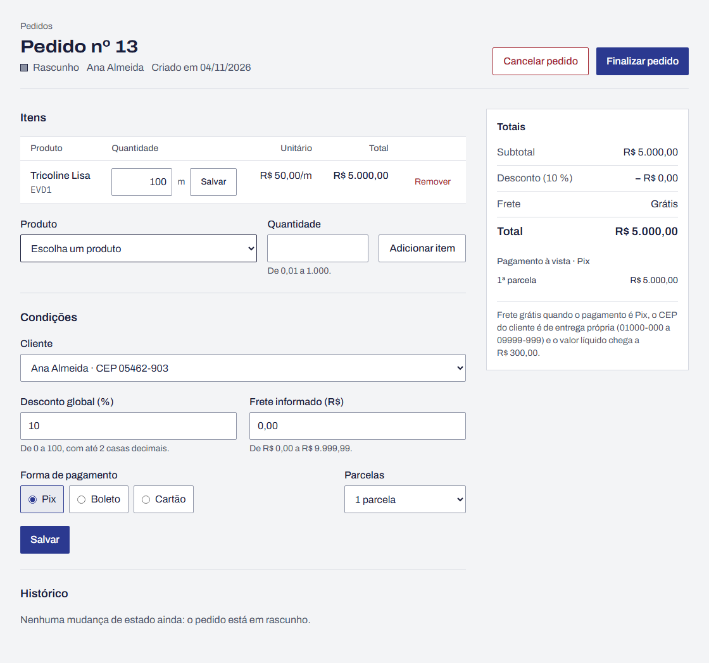

# BUG-01 · Desconto global some do total depois de editar a quantidade

**Esperado:** R$ 4.500,00 (100 m × R$ 50,00 = R$ 5.000,00, menos 10 %) | **Obtido:** R$ 5.000,00

**Severidade:** alta · **Prioridade:** alta

| Campo              | Valor                                                                                            |
| ------------------ | ------------------------------------------------------------------------------------------------ |
| Área               | Pedido · cálculo                                                                                 |
| Requisitos         | RF-17, RF-18                                                                                     |
| Caso de teste      | CT-24 (estados: editar depois de aplicar o desconto)                                             |
| Teste automatizado | `tests/api/orders.test.ts` › "[BUG-01] reaplica o desconto global depois de editar a quantidade" |
| Ambiente           | [Ambiente comum](README.md#ambiente-comum)                                                       |

## Passos para reproduzir

1. Em **Produtos › Novo produto**, cadastre "Tricoline Lisa", unidade metro, preço R$ 50,00.
2. Em **Pedidos › Novo pedido**, escolha a cliente Ana Almeida (CEP 05462-903, área de entrega
   própria) e clique em **Salvar**.
3. Adicione o item Tricoline Lisa com quantidade 50.
4. Em **Condições**, informe desconto de 10 %, pagamento Pix e clique em **Salvar**. O total fica
   em R$ 2.250,00, com frete grátis.
5. Na linha do item, mude a quantidade para 100 e clique no **Salvar** da quantidade.

## Esperado × obtido

| Valor           | Esperado    | Obtido      |
| --------------- | ----------- | ----------- |
| Subtotal        | R$ 5.000,00 | R$ 5.000,00 |
| Desconto (10 %) | − R$ 500,00 | − R$ 0,00   |
| Total           | R$ 4.500,00 | R$ 5.000,00 |

## Evidência

## Observações

- O percentual continua "10 %" nas condições, mas o valor do desconto aparece como R$ 0,00.
- O erro só aparece na edição de quantidade. Clicar de novo em **Salvar** nas condições recalcula
  o pedido e mostra R$ 4.500,00. Quem salva o pedido depois de editar não percebe o problema.
- Parcelas e frete grátis são calculados sobre o valor sem desconto.
- Se o pedido for finalizado logo depois da edição, o total errado fica congelado (RF-24).

## Como ligar o defeito

`RETALHO_BUGS=1 npm run dev`, ou ligue o **Defeito 1** em `/qa/defeitos`.
