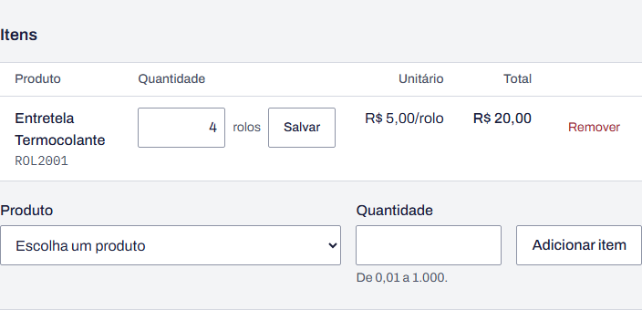
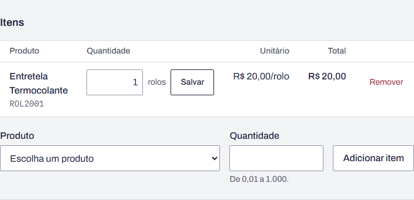

# BUG-02 · Preço unitário errado em rolo com quantidade maior que 1

**Esperado:** R$ 20,00 (5 m × R$ 4,00) | **Obtido:** R$ 5,00 (quantidade 4)

**Observação:** com quantidade 1 o erro não aparece (mascaramento).

**Severidade:** alta · **Prioridade:** alta

| Campo                | Valor                                                                                                                                                  |
| -------------------- | ------------------------------------------------------------------------------------------------------------------------------------------------------ |
| Área                 | Pedido · conversão de unidade                                                                                                                          |
| Requisitos           | RF-05, RF-16                                                                                                                                           |
| Caso de teste        | CT-23 (partição: 1 rolo × 2 ou mais rolos)                                                                                                             |
| Testes automatizados | `tests/unit/units.test.ts` › "[BUG-02] … rolo(s) de 5 m a R$ 4,00/m"; `tests/api/orders.test.ts` › "[BUG-02] rolo de 5 m a R$ 4,00/m com quantidade 4" |
| Ambiente             | [Ambiente comum](README.md#ambiente-comum)                                                                                                             |

## Passos para reproduzir

1. Em **Pedidos › Novo pedido**, escolha a cliente Ana Almeida e clique em **Salvar**.
2. Adicione o item **ROL2001 · Entretela Termocolante** (rolo de 5 m a R$ 4,00/m) com
   quantidade 4.
3. Compare o unitário e o total da linha com o preço do rolo mostrado em **Produtos**
   (R$ 20,00 o rolo de 5 m).
4. Mude a quantidade para 1 e clique no **Salvar** da quantidade.

## Esperado × obtido

| Quantidade | Unitário esperado | Unitário obtido | Total esperado | Total obtido |
| ---------- | ----------------- | --------------- | -------------- | ------------ |
| 4 rolos    | R$ 20,00          | R$ 5,00         | R$ 80,00       | R$ 20,00     |
| 3 rolos    | R$ 20,00          | R$ 6,67         | R$ 60,00       | R$ 20,01     |
| 1 rolo     | R$ 20,00          | R$ 20,00        | R$ 20,00       | R$ 20,00     |

## Evidência

Com 4 rolos:

Com 1 rolo, os valores coincidem com os corretos:

## Observações

- O total da linha fica sempre igual ao preço de um rolo, qualquer que seja a quantidade: o pedido
  cobra 1 rolo e entrega 4.
- Com 1 rolo, o unitário e o total estão certos. Um teste que use só quantidade 1, comum em
  testes de fumaça, passa com o defeito presente. É preciso testar as duas classes da partição:
  1 rolo e 2 ou mais rolos (valor limite nas bordas 1 e 2).
- Itens vendidos por metro ou por unidade não são afetados.

## Como ligar o defeito

`RETALHO_BUGS=2 npm run dev`, ou ligue o **Defeito 2** em `/qa/defeitos`.
