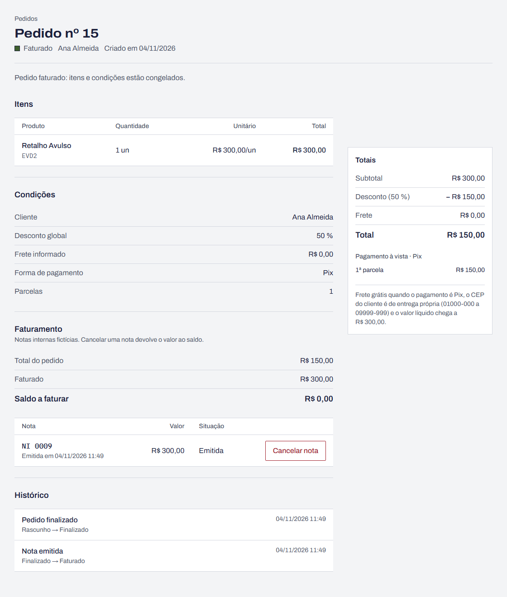

# BUG-03 · Pedido faturado aceita alteração das condições e muda de total

**Esperado:** 409 "O pedido está faturado e não aceita alterações." e total R$ 300,00 |
**Obtido:** alteração gravada; total R$ 150,00

**Severidade:** crítica · **Prioridade:** alta

| Campo                | Valor                                                                                                                                                                                                                                                    |
| -------------------- | -------------------------------------------------------------------------------------------------------------------------------------------------------------------------------------------------------------------------------------------------------- |
| Área                 | Pedido · estados                                                                                                                                                                                                                                         |
| Requisitos           | RF-26, RF-27, RF-31                                                                                                                                                                                                                                      |
| Casos de teste       | CT-46 (estados, pela API), CT-48 (estados, pela tela em duas abas)                                                                                                                                                                                       |
| Testes automatizados | `tests/unit/order-state.test.ts` › "[BUG-03] invoiced + save → ORDER_NOT_EDITABLE"; `tests/api/orders.test.ts` › "[BUG-03] PUT em pedido faturado devolve 409 e o total não muda" e "[BUG-03] desconto de 101 % em pedido faturado devolve 409, não 422" |
| Ambiente             | [Ambiente comum](README.md#ambiente-comum)                                                                                                                                                                                                               |

## Passos para reproduzir pela tela

1. Crie um pedido em rascunho com um item avulso de R$ 300,00 (cliente Ana Almeida).
2. Abra o pedido em duas abas, **A** e **B**.
3. Na aba **B**, clique em **Finalizar pedido** e depois em **Emitir nota** com o saldo inteiro.
   O pedido fica Faturado.
4. Na aba **A**, que ainda mostra o formulário de rascunho, mude o desconto para 50 e clique em
   **Salvar**.
5. Recarregue a aba **A**.

## Passos para reproduzir pela API

```bash
curl -X PUT http://localhost:3000/api/orders/<id> \
  -H 'content-type: application/json' \
  -d '{"customerId":1,"discountPct":50,"freightCents":0,"paymentMethod":"pix","installments":1}'
```

## Esperado × obtido

| Verificação               | Esperado                            | Obtido                 |
| ------------------------- | ----------------------------------- | ---------------------- |
| Resposta do PUT           | 409 `ORDER_NOT_EDITABLE`            | 200                    |
| Estado do pedido          | Faturado                            | Faturado               |
| Total do pedido           | R$ 300,00                           | R$ 150,00              |
| PUT com desconto de 101 % | 409 (estado antes dos dados, RF-31) | 422 `VALIDATION_ERROR` |

## Evidência



## Observações

- O total do pedido deixa de bater com a nota já emitida (R$ 300,00 faturados de um pedido de
  R$ 150,00), e o saldo continua R$ 0,00.
- Só o estado Faturado está afetado: Finalizado, Parcialmente faturado e Cancelado devolvem 409.
  Incluir, editar e remover itens continuam bloqueados também no Faturado.
- A tela não oferece o formulário num pedido faturado; o caminho é a aba desatualizada ou a
  repetição da requisição pela rede (ferramentas do navegador).

## Como ligar o defeito

`RETALHO_BUGS=3 npm run dev`, ou ligue o **Defeito 3** em `/qa/defeitos`.
