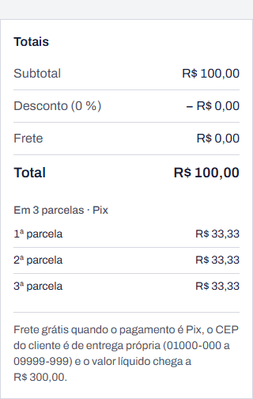

# BUG-04 · Parcelas não somam o total quando a divisão não é exata

**Esperado:** R$ 33,33 + R$ 33,33 + R$ 33,34 = R$ 100,00 | **Obtido:** 3 × R$ 33,33 = R$ 99,99

**Severidade:** média · **Prioridade:** alta

| Campo                | Valor                                                                                                                                                                             |
| -------------------- | --------------------------------------------------------------------------------------------------------------------------------------------------------------------------------- |
| Área                 | Pedido · parcelas                                                                                                                                                                 |
| Requisito            | RF-23                                                                                                                                                                             |
| Casos de teste       | CT-41 (valor limite: divisão não exata), CT-42 (partição: divisível)                                                                                                              |
| Testes automatizados | `tests/unit/installments.test.ts` › "[BUG-04] R$ 100,00 em 3", "[BUG-04] R$ 10,00 em 3", "[BUG-04] R$ 0,10 em 3"; `tests/api/orders.test.ts` › "[BUG-04] R$ 100,00 em 3 parcelas" |
| Ambiente             | [Ambiente comum](README.md#ambiente-comum)                                                                                                                                        |

## Passos para reproduzir

1. Crie um pedido para Ana Almeida com um item avulso de R$ 100,00, sem desconto e sem frete.
2. Em **Condições**, escolha 3 parcelas e clique em **Salvar**.
3. Some as parcelas exibidas nos **Totais**.

## Esperado × obtido

| Total     | Parcelas | Esperado              | Obtido                | Diferença |
| --------- | -------- | --------------------- | --------------------- | --------- |
| R$ 100,00 | 3        | 33,33 + 33,33 + 33,34 | 33,33 + 33,33 + 33,33 | −R$ 0,01  |
| R$ 10,00  | 3        | 3,33 + 3,33 + 3,34    | 3,33 + 3,33 + 3,33    | −R$ 0,01  |
| R$ 0,10   | 3        | 0,03 + 0,03 + 0,04    | 0,03 + 0,03 + 0,03    | −R$ 0,01  |

## Evidência

## Observações

- Totais divisíveis pelo número de parcelas escondem o defeito: R$ 4.500,00 em 3, qualquer
  valor em 1 parcela, valores de centavos pares em 2. Uma massa de teste "redonda" não o encontra.
- A diferença é pequena por pedido, mas se acumula e impede a conciliação entre parcelas e total.

## Como ligar o defeito

`RETALHO_BUGS=4 npm run dev`, ou ligue o **Defeito 4** em `/qa/defeitos`.
