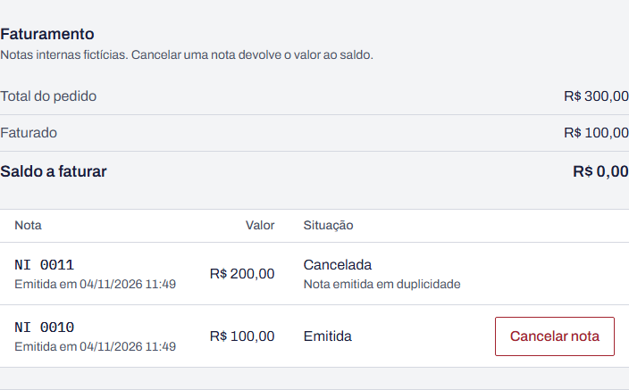

# BUG-05 · Cancelar nota não devolve o saldo e o pedido continua Faturado

**Esperado:** Parcialmente faturado, saldo R$ 200,00 | **Obtido:** Faturado, saldo R$ 0,00

**Severidade:** alta · **Prioridade:** alta

| Campo                | Valor                                                                                                                                                                                                                                                                      |
| -------------------- | -------------------------------------------------------------------------------------------------------------------------------------------------------------------------------------------------------------------------------------------------------------------------- |
| Área                 | Faturamento · saldo                                                                                                                                                                                                                                                        |
| Requisitos           | RF-33, RF-34 (efeitos em RF-30 e RF-38)                                                                                                                                                                                                                                    |
| Casos de teste       | CT-56 (estados: caminho de volta), CT-52 (histórico), CT-61 (igualdade do painel)                                                                                                                                                                                          |
| Testes automatizados | `tests/api/invoices.test.ts` › "[BUG-05] devolve o saldo e recalcula o estado do pedido" e "[BUG-05] finalizar, faturar em duas notas e cancelar uma gera quatro registros"; `tests/api/dashboard.test.ts` › "[BUG-05] a igualdade vale depois de emitir e cancelar notas" |
| Ambiente             | [Ambiente comum](README.md#ambiente-comum)                                                                                                                                                                                                                                 |

## Passos para reproduzir

1. Crie e finalize um pedido de R$ 300,00 (item avulso, cliente Ana Almeida).
2. Emita uma nota de R$ 100,00 e outra de R$ 200,00. O pedido fica Faturado.
3. Na seção **Faturamento** do pedido, clique em **Cancelar nota** na nota de R$ 200,00, informe o
   motivo "Nota emitida em duplicidade" e confirme.

## Esperado × obtido

| Verificação            | Esperado                                  | Obtido                          |
| ---------------------- | ----------------------------------------- | ------------------------------- |
| Situação da nota       | Cancelada                                 | Cancelada                       |
| Estado do pedido       | Parcialmente faturado                     | Faturado                        |
| Faturado               | R$ 100,00                                 | R$ 100,00                       |
| Saldo a faturar        | R$ 200,00                                 | R$ 0,00                         |
| Nova nota de R$ 200,00 | Aceita (201)                              | Recusada (409, pedido faturado) |
| Histórico              | Registro Faturado → Parcialmente faturado | Nenhum registro novo            |

## Evidência

## Observações

- O pedido fica preso: tem R$ 200,00 sem nota, mas não aceita nova nota porque continua Faturado.
- No painel, a igualdade vendido = faturado + a faturar deixa de valer: o faturado cai
  R$ 200,00 e o a faturar não sobe (RF-38).
- O total faturado da lista de notas está certo; a inconsistência está no pedido.

## Como ligar o defeito

`RETALHO_BUGS=5 npm run dev`, ou ligue o **Defeito 5** em `/qa/defeitos`.
