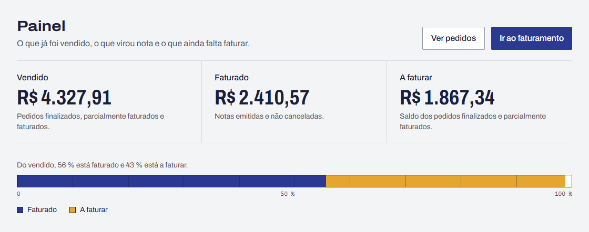
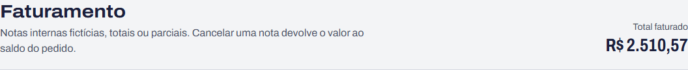

# BUG-06 · Painel mostra faturado menor que o total da lista de notas

**Esperado:** painel e lista com R$ 2.510,57 | **Obtido:** painel R$ 2.410,57; lista R$ 2.510,57

**Severidade:** média · **Prioridade:** média

| Campo              | Valor                                                                                                                 |
| ------------------ | --------------------------------------------------------------------------------------------------------------------- |
| Área               | Painel · consistência                                                                                                 |
| Requisitos         | RF-37, RF-39                                                                                                          |
| Caso de teste      | CT-60 (estados, com oráculo de comparação entre telas)                                                                |
| Teste automatizado | `tests/api/dashboard.test.ts` › "[BUG-06] depois de emitir e cancelar notas, painel e lista mostram o mesmo faturado" |
| Ambiente           | [Ambiente comum](README.md#ambiente-comum)                                                                            |

## Passos para reproduzir

1. Abra o **Painel** e anote o faturado (R$ 2.410,57 na massa usada).
2. Em **Faturamento**, no primeiro pedido a faturar, informe R$ 100,00 e clique em
   **Emitir nota**.
3. Compare o **Total faturado** do topo da tela de Faturamento com o faturado do **Painel**.

## Esperado × obtido

| Momento                     | Painel (esperado) | Painel (obtido) | Lista de notas |
| --------------------------- | ----------------- | --------------- | -------------- |
| Antes da nota               | R$ 2.410,57       | R$ 2.410,57     | R$ 2.410,57    |
| Depois da nota de R$ 100,00 | R$ 2.510,57       | R$ 2.410,57     | R$ 2.510,57    |

## Evidência

Painel depois da nota:

Total da lista de notas no mesmo momento:

## Observações

- O painel só fica desatualizado se tiver sido aberto antes da nota. Quem abre o painel pela
  primeira vez depois da emissão vê o valor certo.
- Finalizar ou cancelar outro pedido corrige o painel sozinho: depois de finalizar um rascunho, o
  painel passou a mostrar R$ 2.510,57. Isso torna o defeito intermitente para quem não compara as
  telas logo após a nota.
- Cancelar nota tem o mesmo efeito: o faturado do painel não cai.

## Como ligar o defeito

`RETALHO_BUGS=6 npm run dev`, ou ligue o **Defeito 6** em `/qa/defeitos`.
