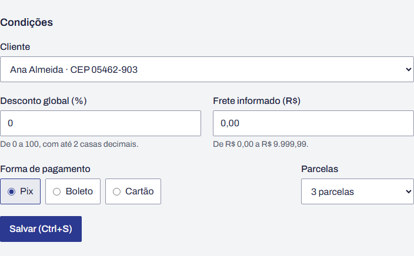

# BUG-07 · Botão "Salvar" anuncia Ctrl+S, que abre o "Salvar página"

**Esperado:** botão "Salvar", sem atalho anunciado | **Obtido:** "Salvar (Ctrl+S)" com
`aria-keyshortcuts="Control+S"`; Ctrl+S abre o diálogo do navegador

**Severidade:** média · **Prioridade:** média

| Campo              | Valor                                                                                                        |
| ------------------ | ------------------------------------------------------------------------------------------------------------ |
| Área               | Interface · atalho                                                                                           |
| Requisito          | RF-40                                                                                                        |
| Caso de teste      | CT-62 (partição: rótulos com e sem atalho reservado)                                                         |
| Teste automatizado | `tests/unit/labels.test.ts` › "[BUG-07] o botão de salvar o pedido se chama \"Salvar\" e não anuncia atalho" |
| Ambiente           | [Ambiente comum](README.md#ambiente-comum)                                                                   |

## Passos para reproduzir

1. Abra um pedido em rascunho.
2. Leia o botão no fim da seção **Condições**.
3. Mude o desconto e pressione Ctrl+S, como o botão sugere.

## Esperado × obtido

| Verificação         | Esperado                | Obtido                                                   |
| ------------------- | ----------------------- | -------------------------------------------------------- |
| Texto do botão      | Salvar                  | Salvar (Ctrl+S)                                          |
| `aria-keyshortcuts` | ausente                 | `Control+S`                                              |
| Efeito de Ctrl+S    | nenhum atalho anunciado | O navegador abre o "Salvar página"; o pedido não é salvo |

## Evidência

## Observações

- O sistema não trata a combinação: o atalho anunciado leva o usuário a salvar a página HTML e a
  acreditar que salvou o pedido.
- Mesmo que o sistema tratasse Ctrl+S, disputaria a combinação com o navegador. O leitor de tela
  também anuncia um atalho que não funciona.
- Heurística que encontra o defeito: consistência com as convenções da plataforma.

## Como ligar o defeito

`RETALHO_BUGS=7 npm run dev`, ou ligue o **Defeito 7** em `/qa/defeitos`.
